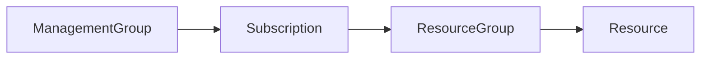

Governance is about a set of rules that need to be followed.
In cloud, the way of doing things is different.
Governance in cloud consists of:
[policy](/til/azure-policy) - What can you do?
[RBAC](/til/azure-rbac) - Who?
[budget](/til/azure-cost-management) - How much?

["Azure"](/til/azure-master) is shared compliance model.

# How to use constructs for governance

The closer you get to the resource, the stricter the policies can be.
At root [management group](/til/management-groups) level for example, you want broad policies that need to apply. Least restrictive. And so on.

---
# references:
https://www.youtube.com/watch?v=eLSjnF6Crlw&list=PLlVtbbG169nGlGPWs9xaLKT1KfwqREHbs&index=12
[Azure Governance](https://learn.microsoft.com/en-us/azure/governance/)