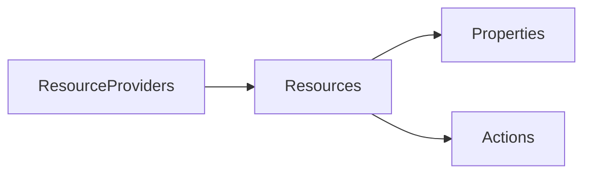

# Resource structure

- Azure Resource Manager (ARM) replaced Azure Service Manager
- ARM Resource providers have n number of resources under them
- Resources have properties and actions
- Querying ARM can be slow and expensive. There is a quota. So we use [Azure Resource Graph](/til/azure-resource-graph)
- 1 [resource](/til/azure-resources) can be a member of only 1 [RG](/til/resource-groups)
- 1 [resource](/til/azure-resources) and [resource groups](/til/resource-groups) is tagged to a single [subscription](/til/azure-subscriptions)