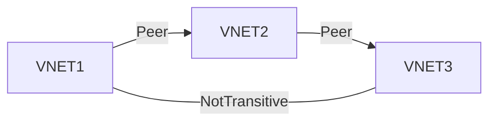

- One of the options for [Connecting virtual networks](/til/connecting-virtual-networks) / the best option
- Peered traffic goes on Azure Backbone network and is private
- When Networks are peered, we can use [Azure VPN Gateway](/til/azure-vpn) in the peered network for [Connecting to Onprem](/til/connecting-to-onprem)
	- Gateway transit makes it so, that I don't have to setup a [Azure VPN Gateway](/til/azure-vpn) in the peer [VNet](/til/azure-vnet)
- [Create VNet Peering in Azure](/til/create-vnet-peering-in-azure)
	- When creating [VNet Peering](/til/vnet-peering) with az cli or [Powershell](/powershell) only one side of peering gets created. We need to create both sides.
- Typical topology is hub and spoke
	- VNET2 below is hub
	- Typically you will put the [Azure VPN Gateway](/til/azure-vpn) in this hub network and let other networks use it. Same for other things like NVAs
- Not transitive i.e. VNET1 can not talk to VNET3 / Need to create peering relationship between them
	- Without peering, I could add Azure Firewall or Network virtual appliance in Hub network (VNET2) and tell:
		- VNET3 if you want to talk to VNET1, next hop is IP of that forwarder
		- VNET1 if you want to talke to VNET3, next hop is IP of that forwarder
	- This above thing is UDR (User defined routing)
- If we add a new ip address space to one vnet, we just need to sync peering not re-create peering or anything

# Types
- global ([VNet](/til/azure-vnet) in different regions)
- regional ([VNet](/til/azure-vnet) in same region)

---
# references:
[MS Learn](https://learn.microsoft.com/en-in/training/modules/integrate-vnets-with-vnet-peering/2-connect-services-using-vnet-peering)
> To enable gateway transit, configure the **Allow gateway transit** option in the hub virtual network where you deployed the gateway connection to your on-premises network. Also configure the **Use remote gateways** option in any spoke virtual networks.